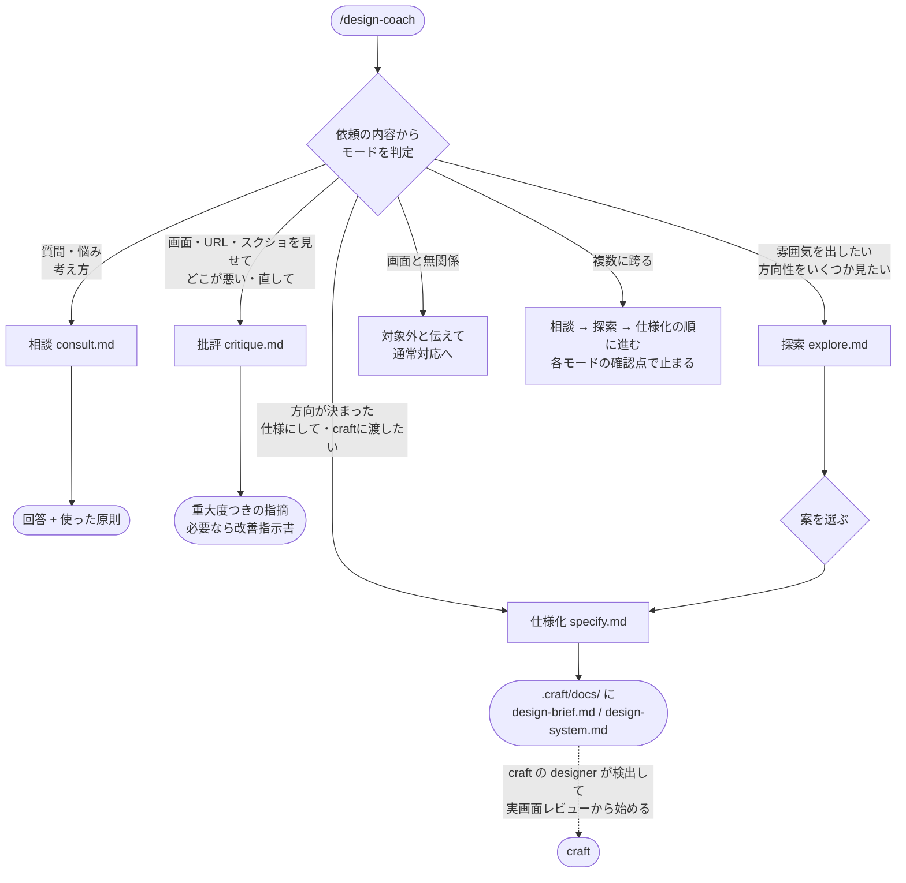

# design-coach

Web UI・ビジュアルデザイン（画面の見た目）の相談役兼師匠となるスキル。配色・タイポ・余白・レイアウト・表現手法・情報設計・アクセシビリティの判断を、**理由（原則名）つき**で返す。決まった方向は、craft が読める `design-brief.md` / `design-system.md` として出力する。

出力生成より「判断軸の言語化」を優先する。想定する利用者は、デザインの判断軸を身につけたいエンジニア。

`/design-coach` で起動する。「この画面どう直す」「この雰囲気を出したい」「デザインを教えて」などの依頼でも、自動で選ばれる。

## 担うこと・担わないこと

| 担う | 担わない |
|------|---------|
| 画面の見た目・構成・情報設計（OOUI、ナビ、フォーム・テーブル）・アクセシビリティの相談 | 実装コード（成果物は方針・指摘・HTMLモック・仕様ファイルまで。実装はメインのClaudeか craft） |
| LP・ブランドサイトの表現、業務系UIの質 | グラフ・チャートの配色（`dataviz` スキル） |
| 探索のHTMLモックと、仕様ファイルの生成 | 写真・動画の素材、CI/VI、商用書体、作り込んだモーション（`references/assets-and-limits.md`） |
| | 画面と無関係なシステム設計（DB、API など） |

## 起動フロー



- 曖昧なときだけ、番号リストで1回確認する。
- 実装コードの依頼は、方針までを担い、実装は渡す。
- 「上級デザイナーと同等」「あのサイトと同じ」を求められたときは、先に `references/assets-and-limits.md` で、再現できる層とできない層を仕分けて伝える。

## 共通原則（全モード）

- **助言には必ず理由を添える**（原則名と効果を1〜2行）。長い講義にはしない
- **実装コードは書かない**
- **ファイルの作成・編集は、場所と内容の方針を示し、了承を得てから行う**
- **確認済み（◎○）と未検証（△）を区別して答える。** 確信が持てない事実は「経験則・要確認」と明示する。数値の基準は公式（WCAG、デジタル庁DS）を優先する
- 判断が必要な場面は、勝手に決めず、番号リストで確認する
- AI が出しがちなデフォルト（理由なき青プライマリ、グレーのみ、Inter のみ、均等3カラムのカード）を避ける
- 回答の末尾に `使った原則:` を1行添える

### 一任モード

「おまかせ」「全て任せる」「好きに進めて」と言われたときは、判断の権限が委ねられている。確認のために止まらず、**仮説で前提を埋めて進め、「採用した前提」を明示する**。聞くのは、外れると手戻りが大きい論点（ブランド名、既存のロゴ・ブランドカラー、法的制約、工数の上限）だけ。

- 提示では、推奨案・理由・外した理由を必ず出す。推奨は、覆せる形で出す
- 推奨は無難（抑制・上質）に偏りやすい。広告LP・ポートフォリオなど「一瞬で目を引く」ことが成果の画面は、強さと独自性を優先し、3案のうち1案は大胆さを最大にする
- 「探索から仕様化まで進めたい」は、推奨案での仕様化へ進む許可として扱う。ただし「確認したら次へ」などの段取りが書かれているときは、仕様化の後に確認を挟む
- 実行の記録（依頼の原文、採用した前提、成果物の索引）を、指定された場所（例: `test-record/`）に残す
- 一任でも、グローバル設定（このスキル自身のファイルなど）の変更は、影響範囲を示して確認する

## modes/（4つのモード）

モードのファイルは独立したスキルではない。`SKILL.md` が、依頼に応じて Read して従う。

| モード | ファイル | 用途 | 入力 | 出力 | 確認点（WAIT_FOR） |
|--------|---------|------|------|------|-------------------|
| 相談 | `modes/consult.md` | 作る前の「考え方」。判断相談、概念質問、進め方、比較 | 質問・悩み | 結論 → 理由（原則名）→ 具体値（px・色コード・比率） | 前提が欠けるとき、最大3問まとめて聞く |
| 批評 | `modes/critique.md` | 既存の画面の問題点を、優先度つきで指摘する | スクリーンショット、URL、ローカル開発サーバー、既存プロジェクト | 重大・中・軽微・外部依頼に分けた指摘（最大12件）と、良い点。必要なら `design-improvements.md` | 改善指示書の出力先と内容の了承 |
| 探索 | `modes/explore.md` | 方向性を2〜3案、HTMLモックで見せて選んでもらう | 画面の目的、FEEL / ANTI-FEEL、色・フォントの制約 | `mock-A.html` など（案ごとに1ファイル）、比較表、推奨と理由 | 前提の確認、保存先、案の選択（一任モードでは待たない） |
| 仕様化 | `modes/specify.md` | 決まった方向を、craft の designer が読める仕様ファイルにする | 探索の選択結果、または相談で確定した内容 | `design-brief.md`、`design-system.md` | 既存ファイルの上書き確認 |

### 各モードの要点

- **相談**: 進め方を聞かれたときの既定の順序は、目的と利用者 → 情報の優先度 → FEEL / ANTI-FEEL → 色・フォント → スペーシングとグリッドのスケール化 → 主要コンポーネントの状態。装飾やアニメーションは最後。好みの押し付けと、抽象論だけの回答は禁止
- **批評**: 観点は、階層 → 余白とグルーピング → タイポ → 色 → 整列 → 状態とナビ → レスポンシブ → 個性の順。見た目の印象でなく実測値（フォントサイズ、ターゲット、コントラスト）で示す（`references/process/measure.md`）。修正案は、既存のトークンから基準を満たすものを先に探す。自分ではコードを書かない
- **探索**: 案同士は、密度・形・タイポ・色の大胆さ・構図のうち2つ以上を変えて、意図的に離す。提示前に、JS の構文、コントラスト、実ブラウザでの全セクション確認（390px を含む）の自己点検をする。「ブラウザで開いて見てから決める」を選ぶと、見終わった後の選択肢をもう一度出す。モックは判断材料で、実装には流用しない
- **仕様化**: craft のテンプレートを、実行時に Read して複製せずに使う。テンプレートの節構成（見出しの並び）は変えない。コントラスト比は数値で明記する。静的サイト（new-static）に渡す場合は、「0. コンセプト」と「9. 機能要件・完成条件」も埋める

## references/（知識の置き場）

まず `references/INDEX.md` を Read し、**必要なファイルだけ**開く（全部は読まない）。状況の凡例は、◎ 出典を取得して確認済み / ○ 一部確認 / △ 未検証（経験則。数値は断定せず「要確認」と添える）。

| ディレクトリ・ファイル | 内容 |
|----------------------|------|
| `ia/` | 情報設計。OOUI、タスク指向との選択、ナビゲーション、ユーザーフロー |
| `patterns/` | 業務系パターン。フォーム、テーブル、検索・フィルタ、ウィザード、エラーと Undo、空状態、権限と監査ログ、キーボード操作 |
| `theory/` | 原理。ヒック・ミラー・ヤコブ・フィッツなどの法則、ゲシュタルト、認知負荷、視覚階層、ニールセンの10原則 |
| `a11y/` | アクセシビリティ。WCAG 2.2 AA の基準、ARIA |
| `ja/` | 日本語。組版（デジタル庁DS の数値、行高、JLReq）、UX ライティング |
| `visual/` | 色の理論（OKLCH、パレットの構成、役割と比率） |
| `system/` | トークンの命名と、実装への引き渡し |
| `process/` | 評価と実測。ヒューリスティック評価、改善指示書の形式、画面の実測手順（`measure.md`）、実測スクリプト（`audit.js`） |
| `recipes/` | 画面種別（管理画面、入力画面、ダッシュボード、LP、モバイル）ごとの、ファイルの組み合わせ方 |
| 直下のファイル | `typography.md`（タイポ）、`color.md`（配色）、`spacing-layout.md`（余白・グリッド）、`expression.md`（LP・ブランドサイトの表現）、`business-ui.md`（業務系の概要）、`anti-generic.md`（AI っぽさの点検）、`brand-system.md`（モチーフ・一貫性）、`motion-interaction.md`（動き）、`benchmarks.md`（参考サイトの分解）、`assets-and-limits.md`（できること・できないこと） |
| `INDEX.md` | 全ファイルの「いつ読むか」と確認状況の一覧 |
| `maintenance.md` | references の追記・修正のルール |
| `gaps.md` | 未対応の不足の一覧 |

### 数値基準の優先順位

文字サイズ・行高は `ja/typesetting.md`（デジタル庁DS: 本文・UI は 16px 以上、本文の行高は少なくとも 1.5 倍）、コントラストと操作領域は `a11y/wcag.md`（テキスト 4.5:1、非テキスト 3:1）を優先する。直下の `typography.md` などは未検証（△）の部分が多い。

## 出力ファイル

| ファイル | 出力先 | 内容 |
|---------|--------|------|
| `mock-A.html` など | 既定は `<プロジェクト>/.design/explore/`（craft プロジェクトは `.craft/docs/explore/`） | 探索のモック（判断材料） |
| `design-brief.md` | `.craft/docs/` | 業種・色・フォント・アーキタイプ・FEEL / ANTI-FEEL・懸念事項（craft のテンプレートの節構成） |
| `design-system.md` | `.craft/docs/` | カラー（コントラスト実測つき）・タイポ・スペーシング・角丸と影・コンポーネント・動き |
| `design-improvements.md` | `.craft/docs/` | 批評の結果を craft に渡す改善指示書 |

`design-brief.md` と `design-system.md` の冒頭には `<!-- generated-by: design-coach -->` を入れる。

## craft との連携

- 仕様化は、craft の `agents/templates/`（と、静的サイトなら `flows/new-static/design-brief-template.md`）を、実行時に Read して使う
- craft の scope フローの中で、「デザインを先に固めますか」に「design-coach で先に行う」を選ぶと、このスキルが呼ばれる（探索 → 仕様化 → ユーザーの確認 → 環境構築）
- 両ファイルが存在すれば、craft の designer は、ヒアリングを変えない限り、実画面レビュー（フェーズ2c）から始める
- craft 側で `generated-by` を検出する処理は、未実装

## 保守

- references の追記・修正は、`references/maintenance.md` に従い、変更内容を示して了承を得てから行う。`INDEX.md` の該当行も更新する
- 判断できなかった場面や回答が弱かった場面は、`references/gaps.md` への追記を提案する
- 出典は、公式・一次の名前だけを書く（URL、取得日、第三者の記事は書かない）

## ファイル構成

```
design-coach/
├── SKILL.md          # 共通原則とモード判定
├── README.md         # このファイル
├── modes/            # consult / critique / explore / specify
└── references/       # 知識（INDEX.md から辿る）
```
